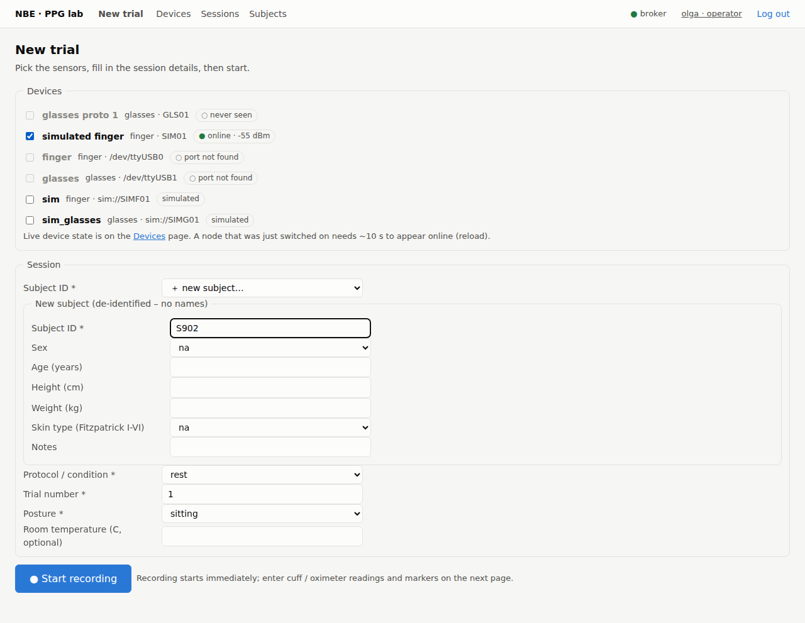
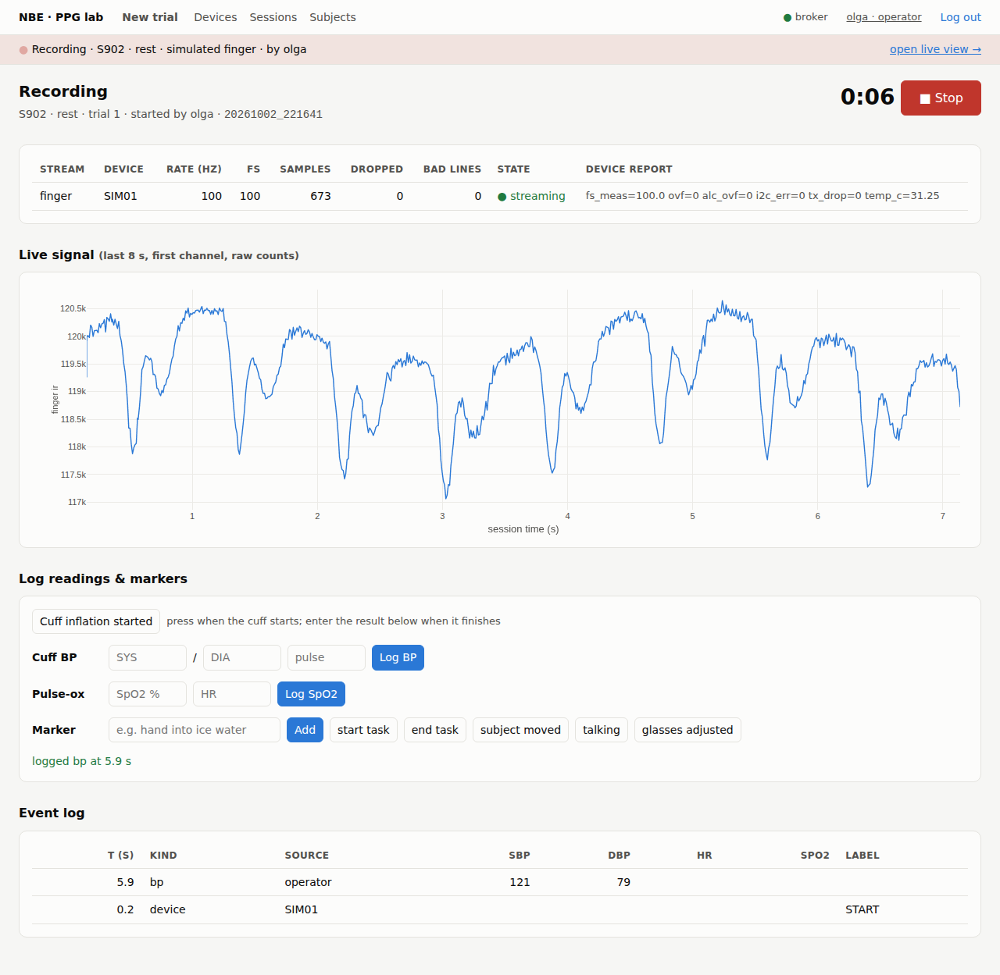
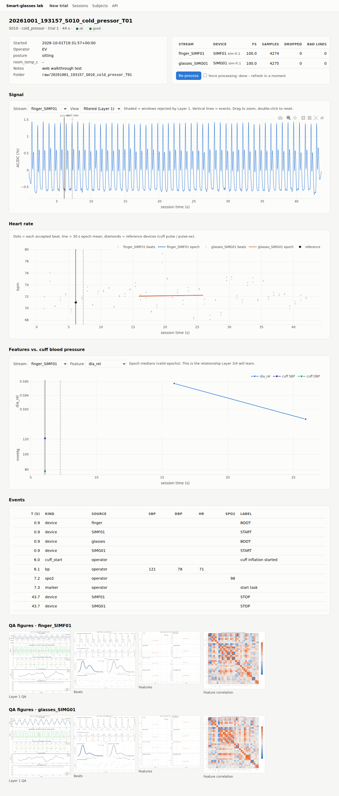

# smart-glasses

NBE smart-glasses PPG project: data acquisition from ESP32 sensors (USB or Wi-Fi/MQTT
nodes), a catalog of every recording, the signal-processing pipeline, and a lab web
server with user accounts – usable on one lab PC or deployed for the whole team.

```
smart-glasses/
├── firmware/                  ← self-contained: share with whoever flashes boards
│   ├── PROTOCOL.md            packet format (USB and MQTT)
│   ├── esp-idf/ppg_stream/    ESP-IDF v6 firmware, XIAO ESP32-S3 + MAX30102, USB or Wi-Fi/MQTT link
│   ├── tools/nbe_node.py      register a node / fetch its credentials into the ESP-IDF project
│   └── arduino/ppg_stream/    older Arduino reference sketch
├── deploy/                    server deployment: DEPLOY.md (step by step), nginx, mosquitto,
│                              systemd, install.sh, backup, server.example.toml
├── config/
│   ├── lab.toml               devices/ports, baud, reference instruments
│   ├── session_fields.toml    metadata asked for every recording (edit freely)
│   ├── pipeline_layer1.json   signal-processing settings (created by `sglab init`)
│   ├── pipeline_layer2.json   beat/feature settings
│   ├── pipeline_layer3.json   reading windows (cuff, pulse-ox), pulse-arrival matching
│   └── sites/<role>.json      per-site overrides (glasses, head), from `sglab tune apply`
├── data/                      (git-ignored – back it up separately!)
│   ├── raw/<session_id>/      IMMUTABLE recordings: session.json, events.csv, <stream>.csv, .rawlog
│   ├── processed/<session_id>/<stream>/   Layer 1–2 outputs + QA figures (re-creatable)
│   ├── datasets/<name>/       Layer 3 training tables (`sglab dataset build`, re-creatable)
│   └── catalog.sqlite         index of everything (re-creatable with `sglab reindex`)
├── src/
│   ├── ppg/                   processing pipeline (Layer 1 conditioning, Layer 2 features, Layer 3 labels)
│   └── sglab/                 lab tool: recorder, catalog, processing runner, web UI,
│                              users/auth, node registry + device CA, MQTT hub
├── scripts/                   one-off helpers (demo data)
├── notebooks/                 exploration
├── tests/                     pytest suite (incl. firmware host simulation, mosquitto mTLS end-to-end)
└── docs/                      data-collection guide, pipeline docs, screenshots
```

**Three rules the layout enforces**

1. **Raw data is never modified.** Everything in `data/raw/` is written once by the recorder.
2. **Everything derived can be regenerated** from raw + code + config (`sglab process --all --force`).
   Each processing run is logged with the pipeline version and a hash of the config.
3. **Files are the truth, SQLite is the index.** Each session folder has a complete
   `session.json`, so the catalog can be rebuilt any time (`sglab reindex`).

## Setup

```bash
python -m venv .venv && source .venv/bin/activate     # Windows: .venv\Scripts\activate
pip install -e ".[dev]"                                # or ".[web]" (lab PC) / ".[server]" (deployment)
sglab init
pytest                                                 # ~1 min
```

Full step-by-step setup + demo checklist: **`docs/SETUP_AND_DEMO.md`**.
Every command, page and config file: **`docs/OPERATIONS.md`**.

## Daily workflow

```bash
sglab ports                          # which serial ports are connected?
sglab record finger glasses          # names from config/lab.toml (or a port, e.g. COM5)
sglab record sim sim_glasses         # practise with simulated devices – no hardware needed
sglab list                           # what do we have?
sglab show S003                      # details of a session (any unique part of its id)
sglab process --all                  # run Layers 1–2 on anything new
sglab dataset build                  # Layer 3: cuff readings + PPG windows -> data/datasets/bp/
sglab serve                          # web UI → http://127.0.0.1:8000
sglab serve --lan --token auto       # web UI for the whole local network (prints the links)
```

During `sglab record`, type while the data streams:

| type | logs |
|---|---|
| `c` | cuff inflation started |
| `bp 118/76 70` | cuff result: systolic/diastolic, pulse |
| `ox 98 72` | pulse-oximeter SpO2, HR |
| `m hand in ice water` | marker |
| Enter / `?` | live status (rate, dropped samples, bad lines) |
| `q` | stop → asks the after-recording questions → saves |

Before START it asks subject, protocol, trial (auto-numbered), posture and operator
(remembering your last answers); after STOP it asks quality, notes, keep/discard.
Change those questions in `config/session_fields.toml`.

If the terminal is closed mid-recording, the data is safe in `data/raw/_incoming/`;
run `sglab recover`. Old CSVs from before this tool: `sglab import file.csv --subject S001 --protocol rest`.

## Two ways to run it

| | **Lab PC** | **Team server** (`deploy/DEPLOY.md`) |
|---|---|---|
| sensors | USB, plugged into that PC | Wi-Fi nodes anywhere (MQTT over TLS, one certificate per board) |
| people | whoever can reach the PC (`--token auto`) | user accounts: viewer / operator / admin, audit log |
| trials | one at a time | several at once, each device claimed by one trial |
| start | `sglab serve --lan` | systemd service behind nginx |

Server admin commands: `sglab user …`, `sglab pki …`, `sglab node …`, `sglab sim-node ID`
(fake ESP32 over MQTT), `sglab doctor`, `sglab snapshot` – see `docs/OPERATIONS.md`.

## Web UI

The browser can run the whole experiment, not just show results:
**New trial** (devices, subject, protocol…) → **Live** (stream health, live waveforms,
buttons for cuff/pulse-ox/markers, Stop) → **Finish** (after-questions, save, auto-process)
→ **Session page** with interactive plots. **Devices** shows every node's live state
(online, RSSI, firmware, in use by whom); admins register nodes and users in the browser.

| New trial | Live |
|---|---|
|  |  |



## Docs

- `docs/SETUP_AND_DEMO.md` – install + demo checklist with what to verify
- `docs/OPERATIONS.md` – every command, web page, API endpoint and config file
- `docs/DATA_COLLECTION.md` – how to run a session, protocols, what goes where
- `deploy/DEPLOY.md` – the team server: LXC + Ubuntu web VM, nginx, mosquitto, backups
- `firmware/README.md` – flashing Wi-Fi nodes with `nbe_node.py`
- `firmware/PROTOCOL.md` – the ESP32 packet format (USB and MQTT)
- `firmware/esp-idf/ppg_stream/README.md` – build, flash, menuconfig, wiring, first hardware test
- `docs/pipeline/PIPELINE.md` – Layers 1–2: what every step does and why
- `docs/pipeline/TUNING.md` – tuning Layers 1–2 per sensor site without BP labels (`sglab tune`), with references
